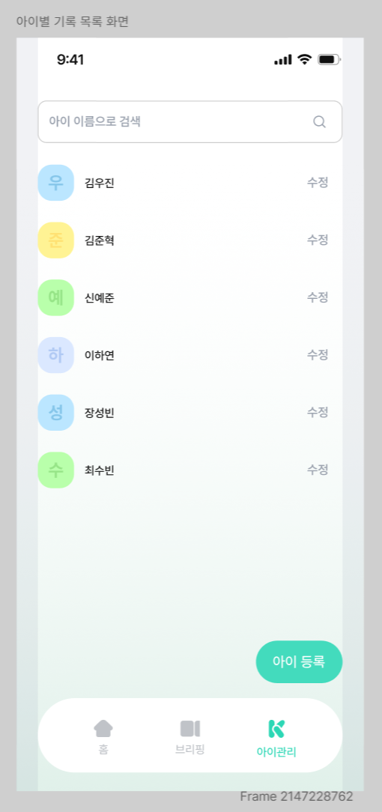

# Spring AI
처음에는 교사가 입력한 문장을 Gemini에 그대로 보내서 응답이 오는지부터 확인했습니다.
실제 기능에서는 처음 브리핑을 만드는 경우와 이미 만든 메시지를 다듬는 경우에 필요한 지시가 달랐습니다.
그래서 application.yml에 생성용과 다듬기용 프롬프트를 따로 두었습니다.
생성할 때는 날짜별 돌봄 기록을 넣고, 다듬을 때는 기존 메시지와 선생님의 수정 요청을 넣었습니다.
예를 들어 “낮잠 이야기를 먼저 해줘”라고 요청하면 문장 순서는 바꾸되, 낮잠 시간이나 수유량은 기존 메시지 그대로 유지하도록 적었습니다.
iOS에서 바로 미리보기에 쓸 수 있게 제목이나 목록 없이 브리핑 본문만 출력하도록 했습니다.

# Gemini 모델 선택과 연동
처음에는 기본 모델인 gemini-2.5-flash로 요청했는데 404가 났습니다.
모델을 바꾼 뒤에도 응답이 오지 않거나 503이 떴습니다.
처음에는 Spring 설정 문제인지 헷갈려서 PowerShell에서 Gemini API를 직접 호출해 봤습니다.
직접 호출에서도 같은 문제가 발생하는 걸 확인했고, 이후 gemini-3.5-flash-lite로 바꿔 로컬에서 브리핑 생성 응답을 받았습니다.

# 브리핑을 다듬을 때 기존 정보 유지
같은 아이의 같은 날짜에 브리핑이 여러 개 쌓이면 화면에서 어떤 메시지를 보여줄지 애매했습니다.
그래서 이미 브리핑이 있으면 기존 ID를 유지하고 본문만 덮어쓰기로 했습니다.
다듬기에서도 AI가 새 본문을 정상적으로 반환했을 때만 저장했습니다.
호출에 실패하거나 빈 답이 오면 기존 메시지가 DB에 남도록 했습니다.

# 홈 화면의 기록 조회 기준
홈에서는 “오늘 있었던 돌봄”과 “가장 최근에 작성한 기록”을 구분할 필요가 있었습니다.
예를 들어 어제 돌봄을 오늘 뒤늦게 입력할 수도 있기 때문입니다.
그래서 오늘 기록에 포함할지는 recordedAt으로 판단하고, 화면에 보여주는 순서는 createdAt 내림차순으로 정했습니다.
오늘 기록이 하나도 없는 담당 아이는 미기록 목록에 넣었습니다.

# QueryDSL을 사용한 아이 검색과 브리핑 집계
아이 목록에서 검색어를 안 보내면 담당 아이 전체를 보여주고, 검색어를 보내면 이름에 그 글자가 들어가는 아이만 보여줘야 했습니다.

목록 조회와 검색 api를 하나로 합쳐서 `/api/v1/kids?keyword=`로 설계했습니다.
화면에서 목록을 띄우는 곳과 검색 결과를 띄우는 곳이 같았고 자동 완성까지는 시간 내에 못 할 것 같아서 화면 진입에서 목록 조회로 아이들을 보여주고 이후 검색을 걸어서 한 번 더 조회하면 자동 완성과 비슷하게 보여 화면 완성도가 높아지지 않을까? 라고 생각했습니다.

JPQL 이나 Native Query는 읽기 복잡하고 타입 안정성을 고려해 QueryDSL로 선택했습니다.
contains()를 사용해 '%이름%' 형태로 검색하기 때문에 `효림`으로 검색해도 `조효림`까지 검색 됩니다.

다만 풀 테이블 스캔을 하기 때문에 성능 문제가 있어서 성능 개선까지가 목표였으나 시간 문제로 실패했습니다!

# EC2 접속에 SSM 사용
배포 후 로그나 DB를 확인하려면 EC2에 접속할 방법이 필요했습니다.
SSH로 접속하는 방법도 익숙했지만, 팀원마다 SSH 키를 관리하고 22번 포트를 열어야 하는 점이 번거로웠습니다.
그래서 EC2의 22번 포트는 닫아두고, 각자 발급받은 IAM 권한으로 AWS Systems Manager Session Manager를 사용했습니다.
운영 DB를 확인할 때도 SSM 포트 포워딩으로 로컬에서 DataGrip을 연결할 수 있게 했습니다.

# Member-id 헤더
로그인 없이 회원 구분하기
해커톤에서는 로그인 기능을 구현하지 않았지만, 홈이나 아이 목록에서는 누가 요청했는지 알아야 그 선생님이 담당하는 아이만 조회할 수 있었습니다.
서버에 데모 회원을 준비하고, iOS가 요청 헤더의 Member-Id에 회원 ID를 보내도록 정했습니다.
서버에서는 이 값으로 회원을 찾고, MemberKid에 등록된 담당 관계를 기준으로 조회하거나 수정할 수 있는 범위를 정했습니다.
Member-Id는 해커톤에서 회원을 구분하기 위해 사용한 값이라, 실제 서비스에서는 로그인으로 확인한 회원 ID를 사용해야 합니다.

# 효림 회고
## 반성
어느 순간부터 개인적으로 이미 세팅해서 검증 된 서버 인프라만 사용했는데 이번엔 민교가 배포를 해보고 싶다고 해서 간만에 배포의 쫄깃함을 느꼈다... 그 과정에서 지금까지 플젝에서 **내가 잘 해서 서버가 안 터진게 아니고 그냥 이미 터질만한 걸 다 고쳐둔 서버라 안 터진 걸 깨달았다.** 아직 배포에 대해 모르는 게 많고 공부를 더 많이 해야겠다고 생각했다 진심으로.........  

## 배운점
예전에 구현해둔 코드(ai 호출)를 가지고 와서 쓰려고 했는데 경민씨가 spring ai를 알려줬다. 사실 이 코드를 구현하고 만족했던 코드였는데 **그 당시에 완벽하게 구현했더라도 지속적으로 유지보수가 필요**하다고 느꼈다. 왜냐하면 예지가 구현한 코드를 봤는데 훨씬 적은 양 코드로 호출이 가능하다!!...

## 잘한점
db를 매번 날리고 다시 만들고 더미 데이터 자동 삽입되게 한 일은 잘한 일!!
막판에 db가 꼬였을 때 (테이블 명 바꾸다가 bonk) 더미 데이터가 sql 파일로 있어서 결단을 내릴 수 있었다. 아니었으면 고치려고 붙잡고 있다가 시연 영상을 제출 직전에 찍게 되었을 것 같다.. 1시간 전에 찍기 성공했는데 이정도면 not bad라고 생각합니다. 그치만 더 빨리 고치지 못해서 아쉽긴 합니다.

## 아쉬운점
내 기능은 시간 여유를 좀 남기고 끝내서 검색 기능 고도화까지 꼭 하고 싶었는데 리드의 책임,으로 다른 팀원들 오류도 계속 같이 보다보니 정작 내 담당 기능 퀄리티가 좀 아쉽다. 그치만 이것도 제가 실력이 부족해서 시간이 부족했던거겠죠... 오히려 팀원들 오류를 같이 보면서 내가 모르던 부분 (ssm을 쓸 때 env 생성 방법 등)을 많이 배웠다.

## 느낀점
게임잼이 아닌 해커톤은 처음인데 리드라 부담x100이었으나 서버 팀원들이 많이 도와주고 기획 분도 팀 분위기를 최상상으로 만들어주셔서 즐겁게 참여했다. 해커톤 전에 좀 세팅을 해왔는데 예지도 민교도 안 써도 되는 기술인데 공부를 목적으로 스스로 해보고 싶다고 참여하고 이런 분위기에서 나도 공부를 정말 더 많이 해야겠다고 다시 느꼈고,. 해커톤 전에 준비할 시간이 많진 않아서 내가 아는 개념은 설명도 해줬는데 질문 받았을 때 내가 모르는 걸 받을까봐 무서웠다... 공부를 더 해서 모르는 게 나왔을 때 무섭기보단 모르는 걸 발견해서 기뻐하는 사람이 되고 싶다!!

# 김예지 회고
아쉬운 점
- S3 저장소, presigned url 세팅해갔는데 못 쓴 것
- OpenAi API로 하고싶었는데 Gemini로 한 것
- 언니들이 말하는 거 못 알아 들은 것.....
- cd.yml 파일에 GEMINI_KEY 안 적어서 서버 터진 것
- Jacoco, CI 잘 몰랐던 것
- 자동화 도구들 잘 몰랐던 것
- 기획 회의 할 때 아이디어 많이 못 낸 것
잘한 점
- AI 세팅
- 각 코드가 어디 위치에서 어느 역할을 수행하고 있는지 이해하려고 한 것
- 모르는 것이 있으면 물어본 것
배운 점
- 테라폼과 data.sql으로 재배포 할 때마다 자동으로 db 채워주는 기능의 중요성
- 테라폼으로 팀원 AWS 권한 관리 및 개인화
- cd 세팅의 중요성
- AI API 연결하는 것
- S3 저장소에 대한 것
- 기타 여러 기능들